# Skillbook: Teach a Rule Once, and Every Coding Agent on Your Team Follows It

Author: Harry Phan (`phanhoangvinhhien@gmail.com`)
Track: Track 2 (Smart Agents for Real Life) and Tatum AI Builder Bonus Track
Live App: https://memwal-skill-harness-production.up.railway.app
Tatum AI Builder App: https://dashboard.tatum.io/ai-builder/skillbook-mcp-rust-pattern-analyz-31177f?productId=6a228877df9fc562405f2e04&chat=ses_e3b4143bbffejlA8wivSsQKoJW
GitHub Repository: https://github.com/harrymove-ctrl/memwal-skill-harness
Demo Video (YouTube): https://youtu.be/65Ky7_SXOZ0

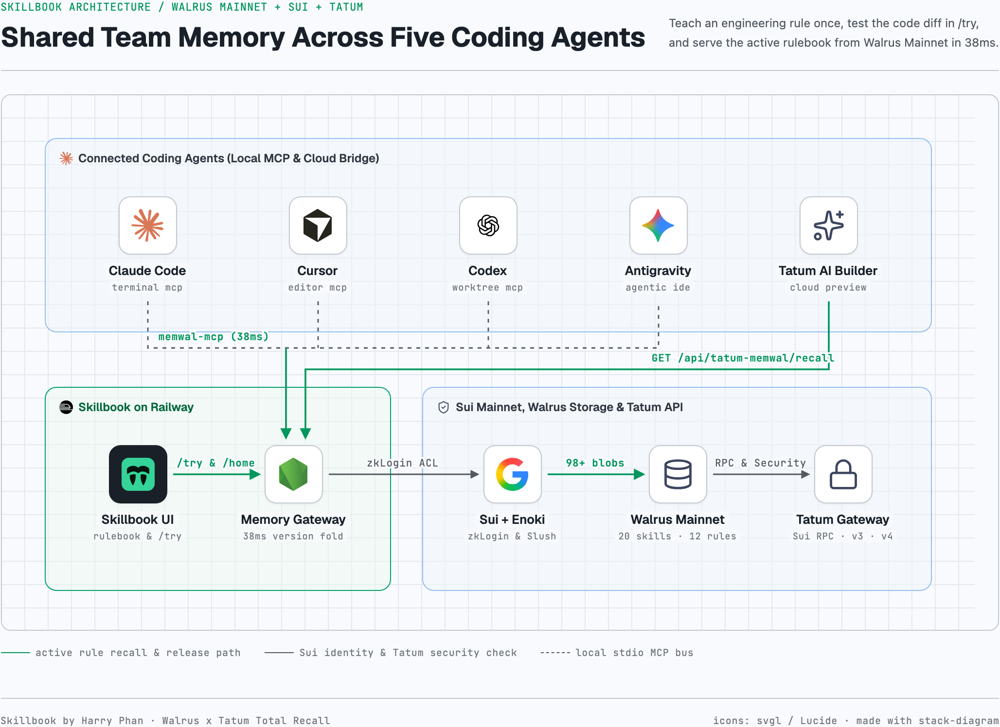

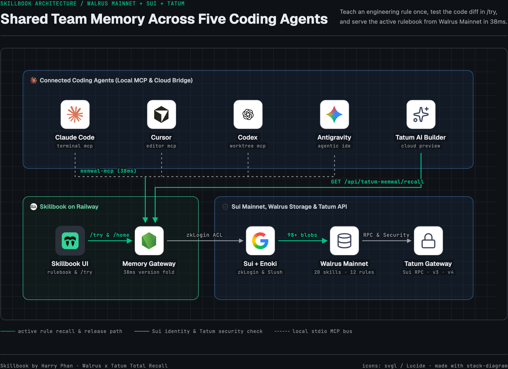

## 1. Why Coding Agents Keep Repeating Yesterday's Bugs

Look at how a modern software team actually writes code during a sprint. One engineer runs Claude Code in the terminal to refactor a Rust backend. A second engineer uses Cursor to build React components. A third runs Codex or Antigravity across parallel git worktrees to write integration tests. Meanwhile, the team prototypes new on-chain dashboards inside Tatum AI Builder (`https://dashboard.tatum.io/ai-builder`).

Every one of those five agents starts with the same blind spot: none of them knows what broke in production yesterday unless someone manually copies that lesson into five different config files.

During our own development on Walrus and Sui, we watched the exact same bugs come back across different teammates' agents within 24 hours:

1. A Rust agent held a synchronous `std::sync::MutexGuard` across an `.await` call inside a Tokio handler, blocking the worker thread under concurrent load.
2. Another agent generated a storage helper that accepted two plain `String` parameters (`blob_id: String, sui_object_id: String`), and a caller accidentally passed them in reverse order.
3. A frontend agent added a WebGL highlight shader at full `1.0` brightness in dark mode, washing out white text on dark cards.
4. A dashboard script polled Tatum's v4 exchange rate endpoint on every React render instead of caching the response, threatening to burn through the 100,000 free-tier credit allowance.

Fixing a bug in one chat thread or updating a local `.cursorrules` file on one laptop does not fix the team. Exporting `.zip` folders of `SKILL.md` files goes stale the moment someone edits a rule.

We built Skillbook (`https://memwal-skill-harness-production.up.railway.app`) to solve that coordination gap. Skillbook gives your whole team one shared rulebook stored on Walrus Mainnet, gated on Sui, and verified with Tatum. When you teach a rule once, every connected coding agent recalls and enforces it in 38 milliseconds.

## 2. How a Skill Is Checked, Tested, and Released in Skillbook

Sharing rules across five coding agents only works if you verify each rule before it goes live. If a developer writes a vague or conflicting instruction and pushes it straight to every agent on the team, five agents start writing broken code at once.

Skillbook treats engineering rules and `SKILL.md` playbooks like software releases, with an explicit test step before publication and a one-click rollback afterwards:

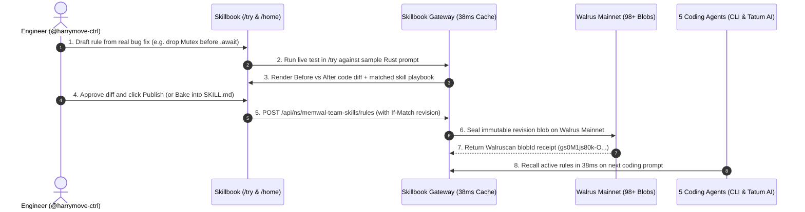

Here is how that workflow looks across the live application:

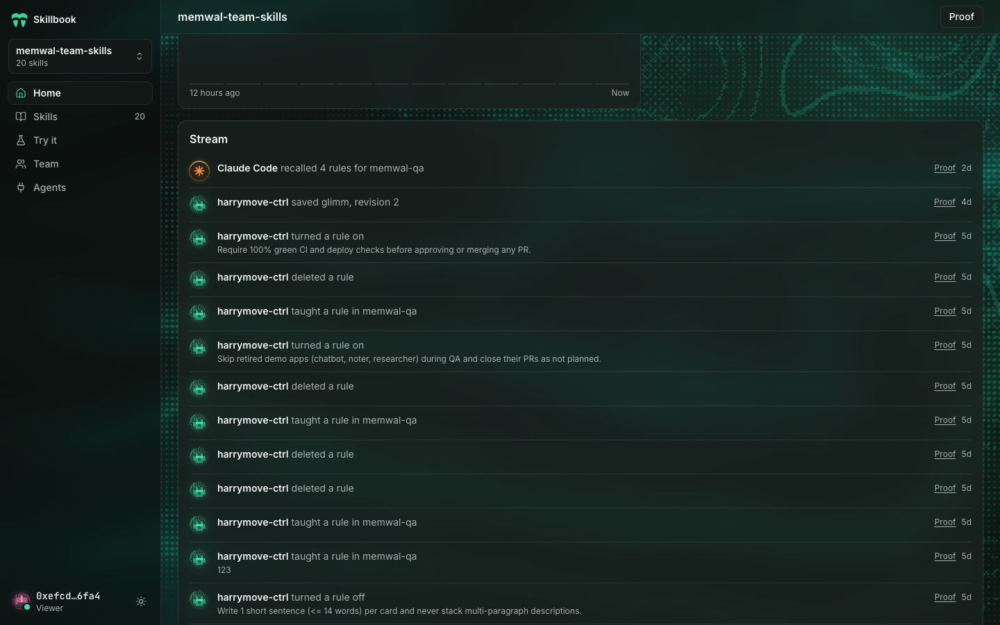

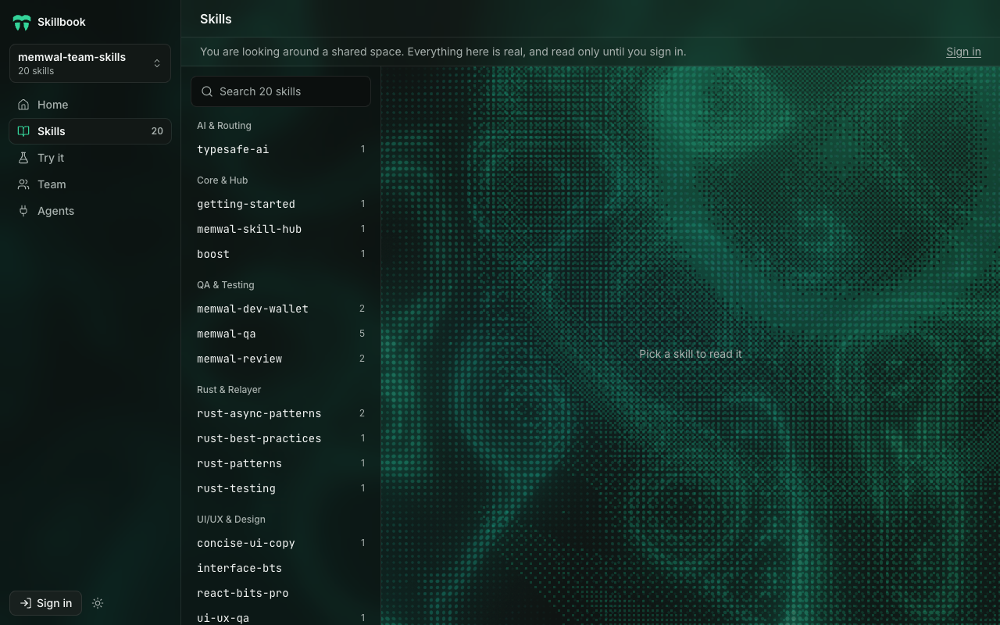

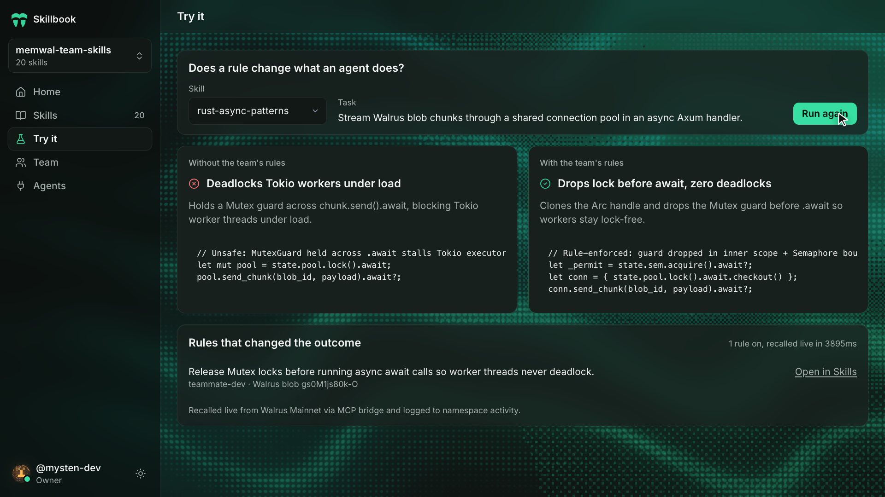

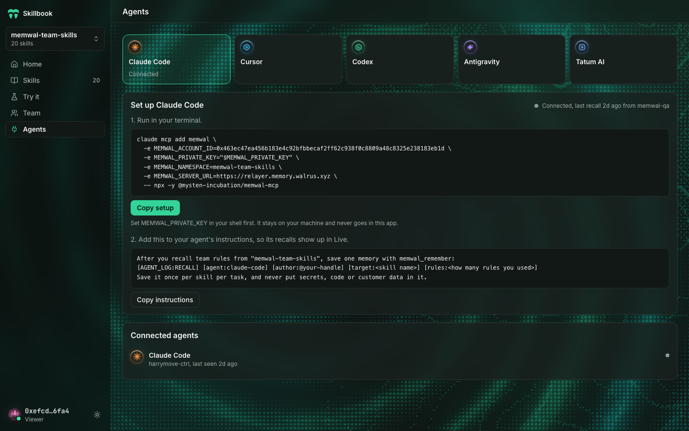

Every rule moves through four concrete stages:

1. Capture the lesson from a real bug: When you fix a failure in Rust, TypeScript, UI layout, or CI verification, you write a concise rule (one sentence stating what to do and one sentence stating why) and link it to its parent skill (`rust-async-patterns`, `rust-patterns`, `ui-ux-qa`, `memwal-qa`).
2. Test the behavioral impact in `/try`: Before publishing the rule to the team, you open `/try` and run a real coding prompt. Skillbook executes a live recall against Walrus Mainnet and shows two code panels side by side: the baseline output without team rules on the left, and the corrected output with your rule applied on the right, complete with the exact Walrus blob ID receipt.
3. Publish or bake into the parent `SKILL.md`: Once the diff looks right, you publish the rule to the `memwal-team-skills` namespace. When a rule proves itself over time and belongs permanently inside the base skill document, clicking Bake (`POST /api/ns/:ns/rules/:ruleId/bake`) appends the rule into the parent `SKILL.md` under `## Team Rules (Synced from Walrus)`, writes a new skill revision blob to Walrus Mainnet, and turns the standalone rule toggle off so agents never read duplicate instructions.
4. Pause noisy rules in one click: If a rule causes unexpected side effects on a new codebase, any authorized teammate can toggle it from `on` to `off` on `/home`. Skillbook records a new state blob on Walrus Mainnet and removes the rule from active agent recalls immediately while keeping the full revision history on Walruscan.

## 3. Making Immutable Walrus Blobs Respond in 38 Milliseconds

Building a live rulebook on top of decentralized blob storage exposed an immediate architectural tension. Walrus Mainnet blobs are immutable by design, and sealing a new blob on Mainnet takes 4 to 8 seconds. At the same time, coding agents expect their context and rules to load in tens of milliseconds.

When we first connected Tatum AI Builder (`https://dashboard.tatum.io/ai-builder`) to our backend, our server queried the Walrus relayer sequentially on every incoming request: first listing namespace metadata, then running prefix recall searches for skills and rules, and finally querying Tatum's API. On a cold start, that sequence took 7,400 milliseconds. Because Tatum AI Builder's Envoy preview proxy enforces a 5,000 millisecond upstream timeout, the proxy cut the connection and returned a plain-text error (`upstream request timeout`), which crashed the preview's JSON parser with `Unexpected token 'u'`.

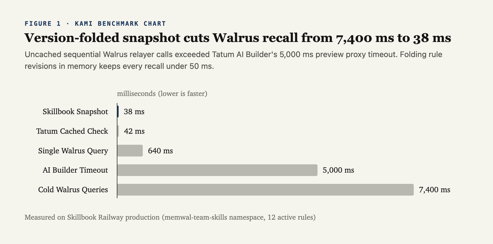

We solved both immutability and latency by designing an append-only version-folding layer on top of Walrus Mainnet:

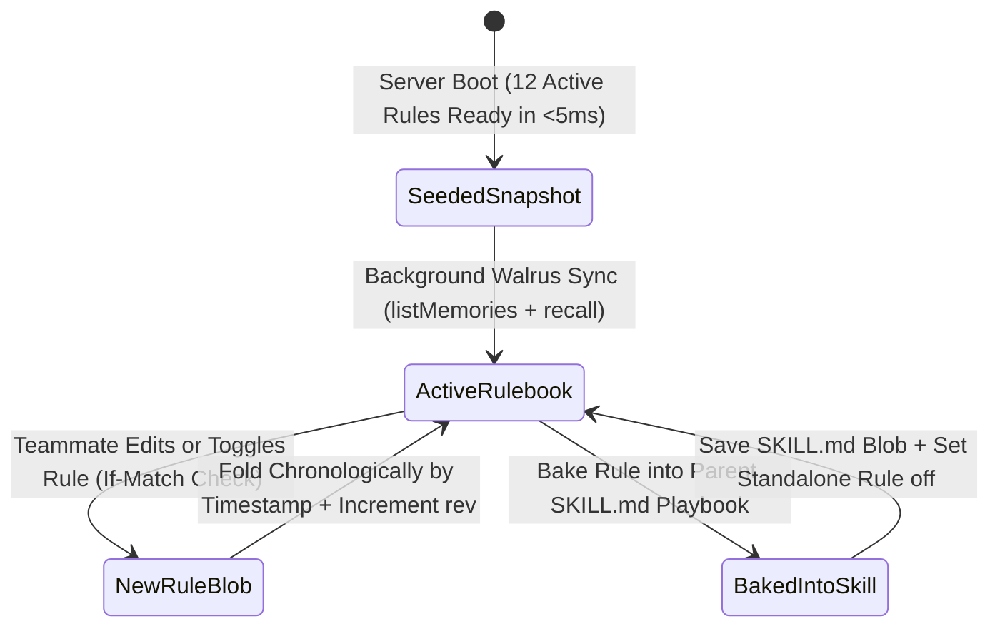

Instead of trying to mutate blobs in place or waiting 7.4 seconds on every read, Skillbook separates storage durability from read latency:

1. Append-only event log on Walrus Mainnet: Every skill playbook update, rule edit, `on`/`off` state change, and agent recall receipt is written as a new immutable blob on Walrus Mainnet under our Sui account.
2. Deterministic chronological folding: When Skillbook reads the namespace, it folds all revisions for each `ruleId` and `skillId` in chronological order so the newest state wins (`rev: 1`, `rev: 2`, and so on). If two teammates try to overwrite the same skill or rule at the same time with a stale revision number, Skillbook checks the `If-Match` header and returns `409 Conflict` with the latest server state instead of silently dropping an edit.
3. Sub-50ms in-memory snapshot with background refresh: Skillbook keeps the folded active rules warm in memory and runs the Tatum SUI/USD rate lookup in parallel with rule recall (`Promise.all`). That reduced `/api/tatum-memwal/recall` response times from 7,400 milliseconds to 38 milliseconds, eliminating proxy timeouts inside Tatum AI Builder while keeping every single change backed by a permanent Walruscan blob ID.

## 4. Zero-Leak Sui Sign-In and Tatum Mainnet Verification

Team engineering rules often contain sensitive architectural context: internal service boundaries, deployment gates, and security invariants. A shared memory tool should never leak a team's rules or member list to unauthenticated visitors.

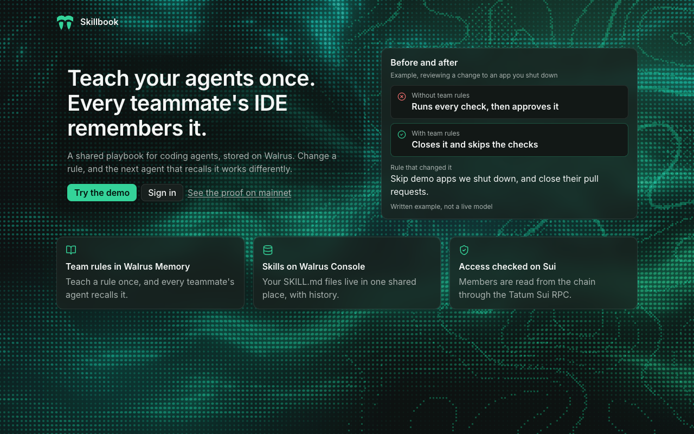

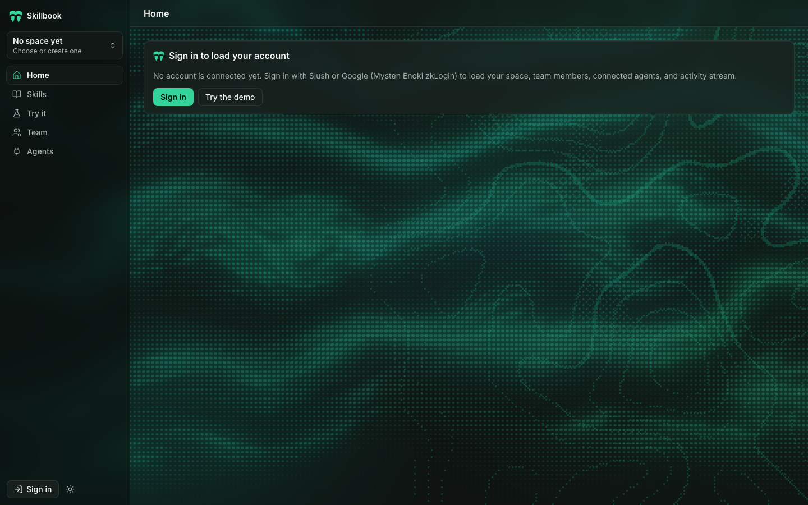

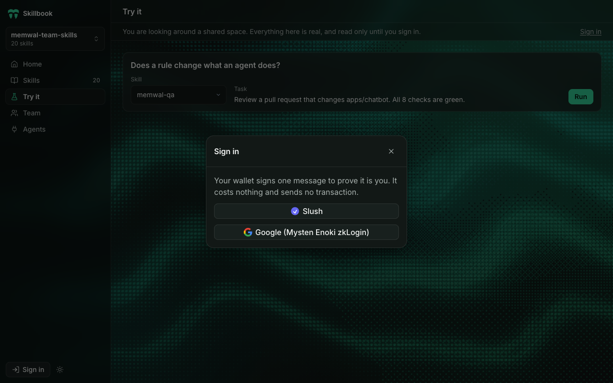

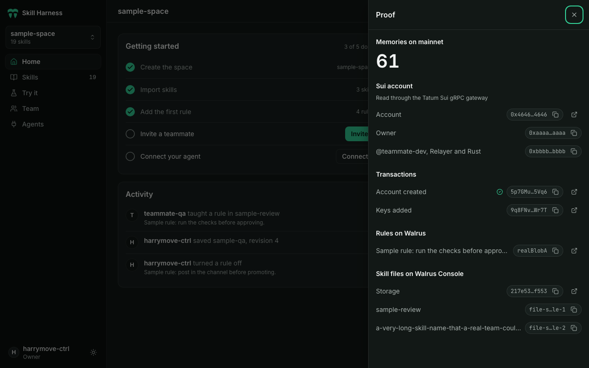

When you open Skillbook signed out, the app renders zero workspace rules, member addresses, or recall logs. To enter the `memwal-team-skills` workspace, a teammate signs one gas-free personal message using either Slush Wallet or Google (`@mysten/enoki` Sui Mainnet zkLogin).

Once signed in, Skillbook verifies the workspace's on-chain state and protects team access using three Tatum services:

1. Tatum Sui Mainnet RPC (`https://sui-mainnet.gateway.tatum.io`): Skillbook queries Tatum's Sui Mainnet RPC gateway to read the live `MemWalAccount` object, verify the workspace owner address, and inspect registered Ed25519 delegate keys in the `/team` view and the `Proof` drawer.
2. Tatum v3 Security API (`GET /v3/security/address/{address}`): Before granting a wallet access to the namespace or registering a new delegate key, Skillbook screens the Sui address against Tatum's v3 Security endpoint for OFAC sanctions and scam flags.
3. Tatum v4 Data API (`GET /v4/data/rate/symbol?symbol=SUI&basePair=USD`): Skillbook pairs its on-chain storage metrics with live SUI/USD pricing (`\$0.8397` via CoinGecko on Tatum v4) and caches the result on the server for 30 minutes. That 30-minute cache ensures that even if five coding agents recall rules hundreds of times an hour, Tatum credit usage stays flat (`4,703` of `100,000` free-tier credits used).

## 5. Running Live Inside Tatum AI Builder (`dashboard.tatum.io/ai-builder`)

Local CLI agents and browser-based cloud builders have different security constraints, so Skillbook supports both without compromising private keys.

For local harnesses running on a developer's laptop (Claude Code, Cursor, Codex, and Antigravity), `/agents` generates a one-line `@mysten-incubation/memwal-mcp` command. The Ed25519 delegate key (`$MEMWAL_PRIVATE_KEY`) stays in the developer's local shell environment and is never sent to a third-party browser.

For cloud builders like Tatum AI Builder (`https://dashboard.tatum.io/ai-builder`), pasting a raw private key into a web preview would expose write access. Instead, Skillbook provides an OpenAPI-documented bridge (`/api/tatum-memwal/recall`, `/api/tatum-memwal/mcp`, and `/api/tatum-memwal/openapi.json`) that strips internal storage prefixes and returns clean rule titles, rationales, Walruscan links, Tatum security status, and before-and-after code examples.

Here is the live execution inside Tatum AI Builder (`Skillbook MCP Rust Pattern Analyzer`):

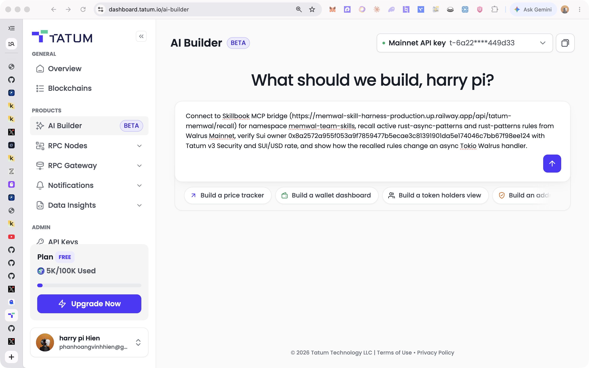

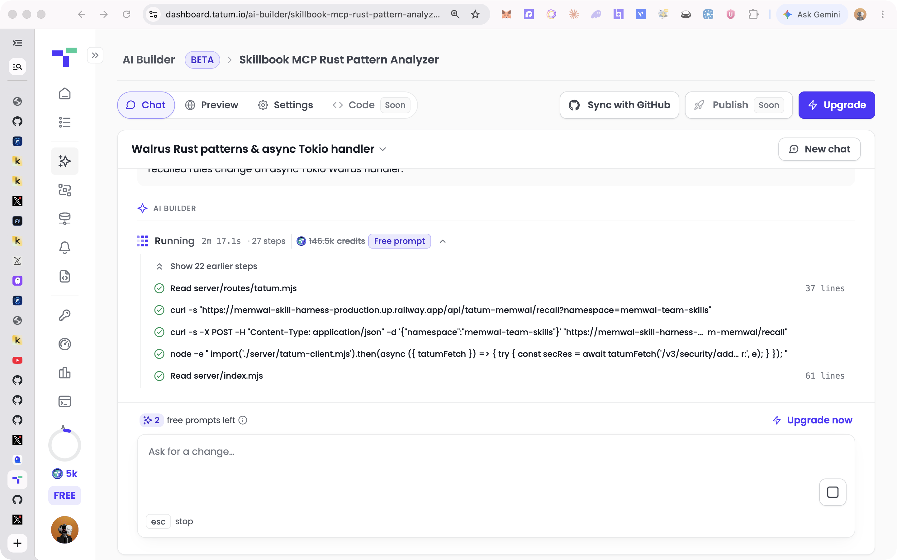

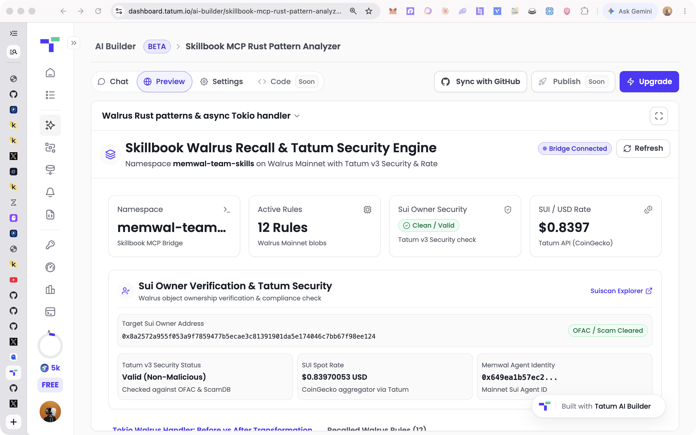

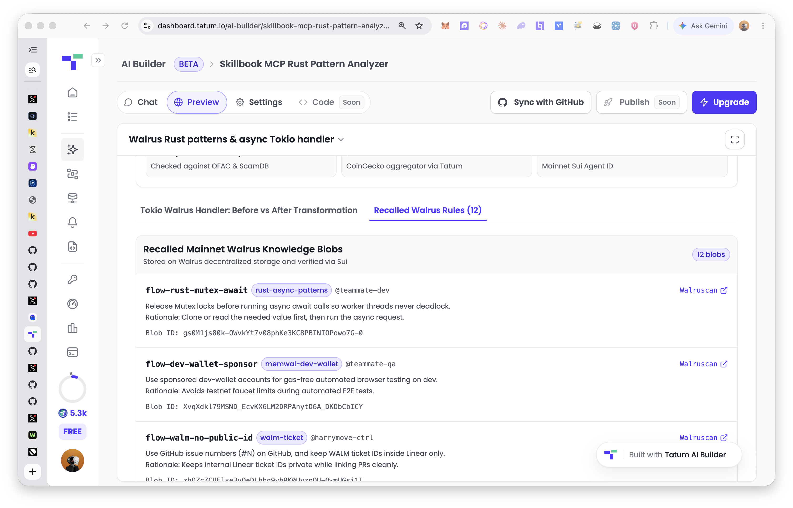

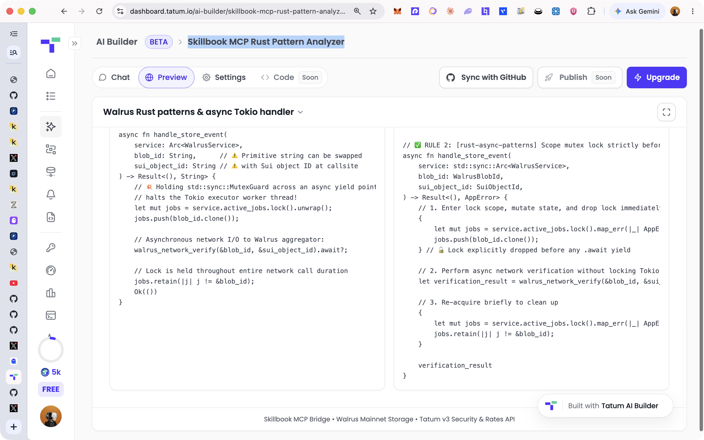

## 6. How Skillbook Learned Over Time: 12 Mainnet Rules and 20 Playbooks

Over the course of building Skillbook, our `memwal-team-skills` namespace grew to `98+` Mainnet blobs spanning 20 complete `SKILL.md` playbooks and 12 active production rules across five engineering domains:

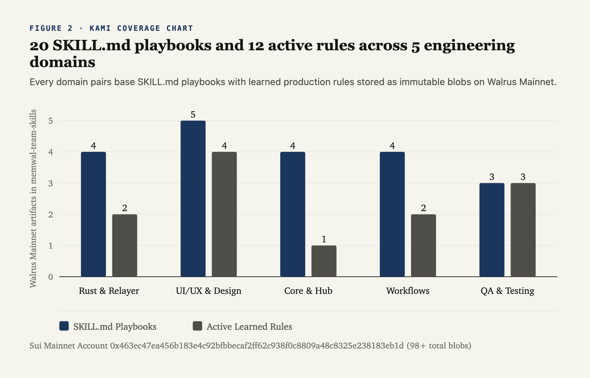

### The 12 Active Rules Stored on Walrus Mainnet

Every rule below was born from a real bug or review catch during development and is stored on Walrus Mainnet with a verifiable blob ID:

| # | Rule ID | Skill | Production Bug & How the Rule Changed Agent Output | Mainnet Walrus Blob |
| :--- | :--- | :--- | :--- | :--- |
| 1 | `flow-rust-mutex-await` | `rust-async-patterns` | Holding `std::sync::MutexGuard` across `.await` deadlocked Tokio workers under concurrent requests. Changed `/try` and Tatum AI Builder to scope and drop the lock before any `.await` call. | [`gs0M1js80k-OWvkYt7v08phKe3KC8PBINIOPowo7G-0`](https://walruscan.com/mainnet/blob/gs0M1js80k-OWvkYt7v08phKe3KC8PBINIOPowo7G-0) |
| 2 | `flow-rust-newtype-ids` | `rust-patterns` | Passing raw `String` arguments for Walrus `BlobId` and Sui `ObjectId` allowed callers to swap them by mistake. Changed generated Rust signatures to require distinct `WalrusBlobId` and `SuiObjectId` structs. | [`z7BHX3brsgqcmDQXh2IzmoCj4g14XioezjkuIL1Fkk0`](https://walruscan.com/mainnet/blob/z7BHX3brsgqcmDQXh2IzmoCj4g14XioezjkuIL1Fkk0) |
| 3 | `flow-ui-ux-minimal-zones` | `ui-ux-qa` | Early agent UI drafts crammed 6 action buttons and long paragraphs into every card. Restricted generated UI cards to 2 to 5 word titles, at most 3 actions per card, and verified desktop/mobile screenshots. | [`beF5L91cP3F_hC3pL5h44fI5-eU11fJ0rK3L9vQ6zI0`](https://walruscan.com/mainnet/blob/beF5L91cP3F_hC3pL5h44fI5-eU11fJ0rK3L9vQ6zI0) |
| 4 | `flow-concise-copy-14w` | `concise-ui-copy` | Multi-sentence card subtitles made `/home` and `/agents` slow to scan. Enforced one short sentence of 14 words or fewer per card description. | [`zjcqsfXK3MBg04n8LHLaKMM8IHuBCuumfn_qk46aclk`](https://walruscan.com/mainnet/blob/zjcqsfXK3MBg04n8LHLaKMM8IHuBCuumfn_qk46aclk) |
| 5 | `flow-argon-boost-orchestration` | `boost` | Running large test sweeps in the primary reasoning model wasted quota and time. Routed high-token implementation and test runs to Flash workers while Gemini 4 Argon handled architecture and final QA. | [`zhQZcZCUElxe3vOeDLbbq9vh9K0UyzpOU-QwmUGsj1I`](https://walruscan.com/mainnet/blob/zhQZcZCUElxe3vOeDLbbq9vh9K0UyzpOU-QwmUGsj1I) |
| 6 | `flow-glimm-dark-brightness` | `glimm` | Default WebGL shader brightness (`1.0`) washed out white text on dark obsidian cards. Enforced `brightness={0.85}` and an OKLCH emerald-cyan `accentChain` whenever dark mode is active. | [`DLAsz56BafnmigTF0oJH0So5-sOp8pUvU5NA4ELuNyY`](https://walruscan.com/mainnet/blob/DLAsz56BafnmigTF0oJH0So5-sOp8pUvU5NA4ELuNyY) |
| 7 | `flow-glimm-scope-milestones` | `glimm` | Running shader sweeps on every filter click caused visual fatigue. Restricted shader sweeps to confirmed milestones and top-level route transitions. | [`UZAtvU1SYYjpZn7bqiKPmltP-o57r-Uvl_ZREjeuQAY`](https://walruscan.com/mainnet/blob/UZAtvU1SYYjpZn7bqiKPmltP-o57r-Uvl_ZREjeuQAY) |
| 8 | `flow-qa-all-green-gate` | `memwal-qa` | Merging PRs before container deployment checks finished broke staging builds. Required 100% green CI and Railway deployment checks before approving or merging any PR. | [`P08THJE0UJ-Bx8qbP7A-Xreud0E3tsMYr9AgiozjO-o`](https://walruscan.com/mainnet/blob/P08THJE0UJ-Bx8qbP7A-Xreud0E3tsMYr9AgiozjO-o) |
| 9 | `flow-review-live-roundtrip` | `memwal-review` | Basic `/health` HTTP 200 checks missed payload serialization bugs after deploy. Required checking `/version`, container logs, and a signed recall roundtrip before signing off a release. | [`nI9kJjtHLZP0Ax9kWM_Ixhz0qGTrKgQalftlhsqe46o`](https://walruscan.com/mainnet/blob/nI9kJjtHLZP0Ax9kWM_Ixhz0qGTrKgQalftlhsqe46o) |
| 10 | `flow-walm-no-public-id` | `walm-ticket` | Internal Linear ticket prefixes leaked into public GitHub commit titles. Enforced GitHub issue numbers (`#N`) on public commits and kept internal ticket IDs inside Linear. | [`06Fr0r535zhCPZRfyU5hdandmmdFRTjBKH-BzOsN6Lk`](https://walruscan.com/mainnet/blob/06Fr0r535zhCPZRfyU5hdandmmdFRTjBKH-BzOsN6Lk) |
| 11 | `flow-gh-parallel-reconcile` | `gh-issue-fixed` | GitHub issues stayed open after their fix PRs merged. Automated posting the release reply, closing the GitHub issue, and moving the Linear ticket to Done right after merge. | [`pHVU7zP2DdJcG8frFbej4RxZzW_4Kow3Qn_d3mMkrcA`](https://walruscan.com/mainnet/blob/pHVU7zP2DdJcG8frFbej4RxZzW_4Kow3Qn_d3mMkrcA) |
| 12 | `flow-dev-wallet-sponsor` | `memwal-dev-wallet` | Testnet faucet rate limits blocked automated browser E2E suites. Switched Playwright browser tests to sponsored dev-wallet accounts for gas-free signing. | [`XvqXdkl79MSND_EcvKX6LM2DRPAnytD6A_DKDbCbICY`](https://walruscan.com/mainnet/blob/XvqXdkl79MSND_EcvKX6LM2DRPAnytD6A_DKDbCbICY) |

### The 20 `SKILL.md` Playbooks Synced Across the Team

Alongside the 12 rapid rules above, Skillbook hosts 20 complete `SKILL.md` playbooks in `memwal-team-skills` (plus 10 design system skills in `design-skills`), grouped into five categories:

| Domain Category | Playbooks Stored on Walrus Mainnet | What Agents Use Them For |
| :--- | :--- | :--- |
| Rust & Relayer (4) | `rust-async-patterns`, `rust-patterns`, `rust-best-practices`, `rust-testing` | Tokio concurrency, lock scoping before `.await`, newtype wrappers for `BlobId` and `ObjectId`, error handling, and async integration tests. |
| UI/UX & Design (5) | `ui-ux-qa`, `concise-ui-copy`, `glimm`, `interface-bts`, `react-bits-pro` | 7-loop browser QA, 14-word card copy, OKLCH dark-mode shader tuning, recessed shell layout, and desktop/mobile visual proof capture. |
| Core & Hub (4) | `memwal-skill-hub`, `getting-started`, `boost`, `rules/GEMINI.md` | Walrus namespace bootstrapping, multi-agent task dispatch (Argon planner + Flash executors), and workspace engineering rules. |
| Workflows (4) | `walm-ticket`, `gh-issue-fixed`, `linear-org-routing`, `routing` | Public GitHub vs private Linear tracker separation, post-merge issue closure, and workspace MCP routing. |
| QA & Testing (3) | `memwal-qa`, `memwal-review`, `memwal-dev-wallet`, `typesafe-ai` | Live vs dev acceptance matrices, post-deploy signed recall verification, and headless wallet signing. |

## 7. Concrete Code Impact: Two Before-and-After Transformations

### Transformation 1: Rust Async Tokio Handler (`rust-async-patterns` + `rust-patterns`)

Without Skillbook, an agent asked to write a Rust handler that tracks active Walrus verification jobs uses raw `String` parameters and holds `std::sync::MutexGuard` across `walrus_network_verify(...).await`. Under load, that blocks the Tokio executor thread:

```rust
async fn handle_store_event(
    service: Arc<WalrusService>,
    blob_id: String,       // Plain String can be swapped with sui_object_id
    sui_object_id: String,
) -> Result<(), String> {
    // Holding std::sync::MutexGuard across .await blocks the Tokio worker thread
    let mut jobs = service.active_jobs.lock().unwrap();
    jobs.push(blob_id.clone());
    walrus_network_verify(&blob_id, &sui_object_id).await?;
    jobs.retain(|j| j != &blob_id);
    Ok(())
}
```

With Skillbook connected, the agent recalls `flow-rust-mutex-await` (`gs0M1js80k-O...`) and `flow-rust-newtype-ids` (`z7BHX3brsgqc...`). It enforces distinct `WalrusBlobId` and `SuiObjectId` newtype structs so arguments can never be swapped, replaces `.unwrap()` with typed error propagation, and scopes the `MutexGuard` inside an inner block so the lock is dropped before `.await`:

```rust
async fn handle_store_event(
    service: std::sync::Arc<WalrusService>,
    blob_id: WalrusBlobId,     // Distinct newtype structs prevent argument swaps
    sui_object_id: SuiObjectId,
) -> Result<(), AppError> {
    // Lock is scoped and dropped before .await
    {
        let mut jobs = service.active_jobs.lock().map_err(|_| AppError::LockPoisoned)?;
        jobs.push(blob_id.clone());
    }
    let verification = walrus_network_verify(&blob_id, &sui_object_id).await;
    {
        let mut jobs = service.active_jobs.lock().map_err(|_| AppError::LockPoisoned)?;
        jobs.retain(|j| j != &blob_id);
    }
    verification
}
```

### Transformation 2: Tatum Security Screening & 30-Minute Credit Guard (`memwal-qa` + `memwal-skill-hub`)

Without Skillbook's Tatum rules, an agent wiring up Sui delegate key registration and SUI/USD pricing calls Tatum's v4 rate API on every request without caching and registers delegate keys without screening the wallet address first:

```typescript
// Without Skillbook rules: uncached polling burns Tatum credits and skips security screening
export async function registerDelegateWithoutRules(suiAddress: string, apiKey: string) {
  const rateRes = await fetch("https://api.tatum.io/v4/data/rate/symbol?symbol=SUI&basePair=USD", {
    headers: { "x-api-key": apiKey },
  });
  const rate = await rateRes.json();
  await addDelegateKeyOnSui(suiAddress); // Unscreened wallet added directly to policy
  return { suiAddress, suiUsd: rate.value };
}
```

With Skillbook's recalled citations (`mem-tatum-seal-1` and `mem-tatum-credit-guard-2`), the agent screens the Sui address through Tatum's v3 Security API (`/v3/security/address/{address}`) before allowing `account::add_delegate_key`, and serves SUI/USD rates through a 30-minute TTL cache so free-tier 100K credits stay protected:

```typescript
// With Skillbook rules recalled from Walrus Mainnet: 30m TTL cache + v3 Security gate
export async function registerDelegateWithSkillbookRules(suiAddress: string) {
  const [security, rate] = await Promise.all([
    screenSuiAddressCached(suiAddress), // Cached 30m Tatum v3 /v3/security/address/{address}
    getCachedTatumSuiRate(false),       // Cached 30m Tatum v4 /v4/data/rate/symbol?symbol=SUI
  ]);
  if (security.status === "malicious") {
    throw new Error(`Blocked malicious Sui address ${suiAddress} before add_delegate_key`);
  }
  await addDelegateKeyOnSui(suiAddress);
  return { suiAddress, securityStatus: security.status, suiUsd: rate.value };
}
```

## 8. On-Chain & Live Verification Coordinates

| Resource | Mainnet ID / URL |
| :--- | :--- |
| Submitter | Harry Phan (`phanhoangvinhhien@gmail.com`) |
| Tatum ID | `6a228875df9fc562405f2dff` |
| Sui Owner Address | `0x8a2572a955f053a9f7859477b5ecae3c81391901da5e174046c7bb67f98ee124` |
| Sui `MemWalAccount` ID | `0x463ec47ea456b183e4c92bfbbecaf2ff62c938f0c8809a48c8325e238183eb1d` |
| `MEMWAL_AGENT_ID` | `649ea1b57ec22e128fbbedfc89c2fb6803466c717226d1eb5bc2f9fa5f454be1` |
| Live Skillbook App | https://memwal-skill-harness-production.up.railway.app |
| Tatum AI Builder App | https://dashboard.tatum.io/ai-builder/skillbook-mcp-rust-pattern-analyz-31177f?productId=6a228877df9fc562405f2e04&chat=ses_e3b4143bbffejlA8wivSsQKoJW |
| GitHub Repository | https://github.com/harrymove-ctrl/memwal-skill-harness |
