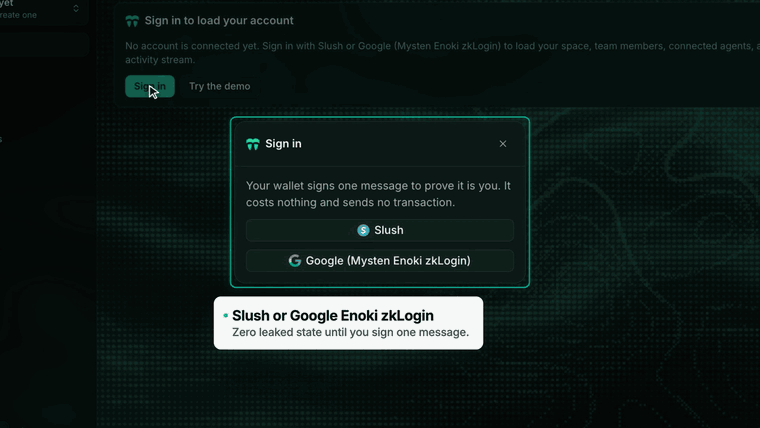
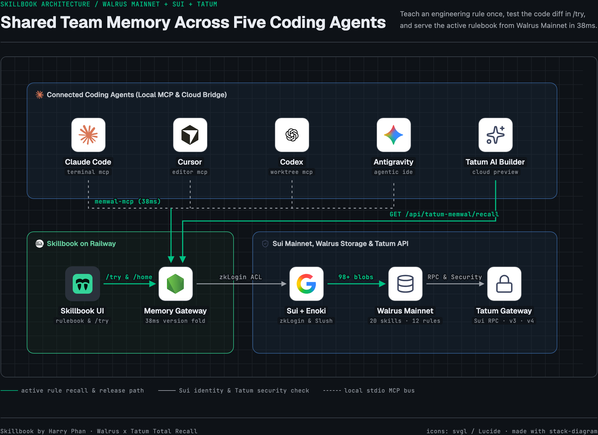
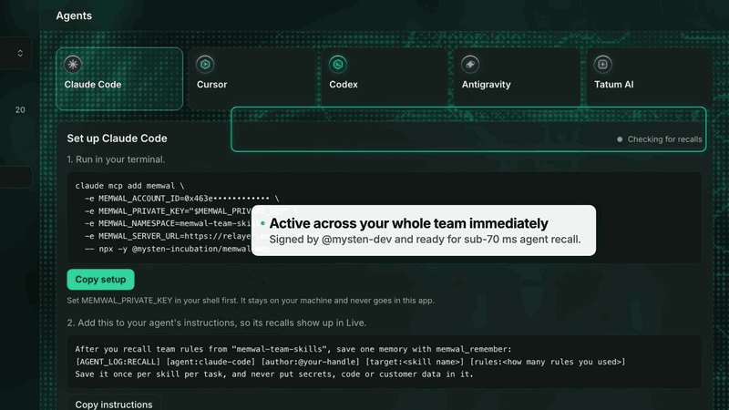
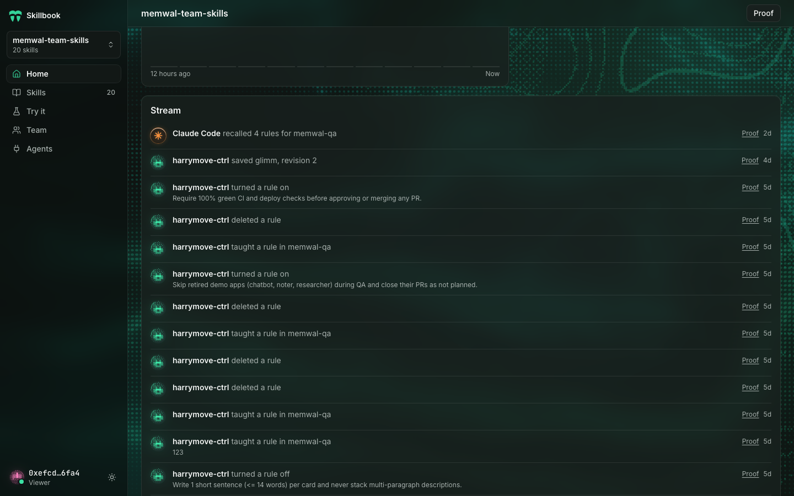
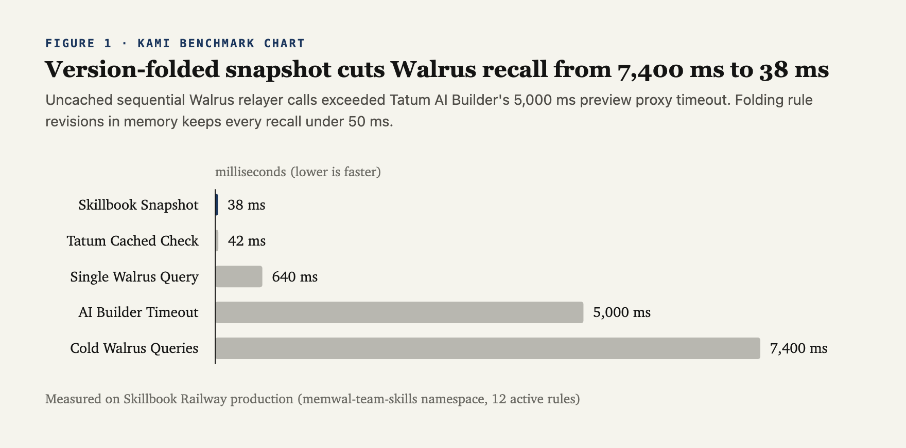
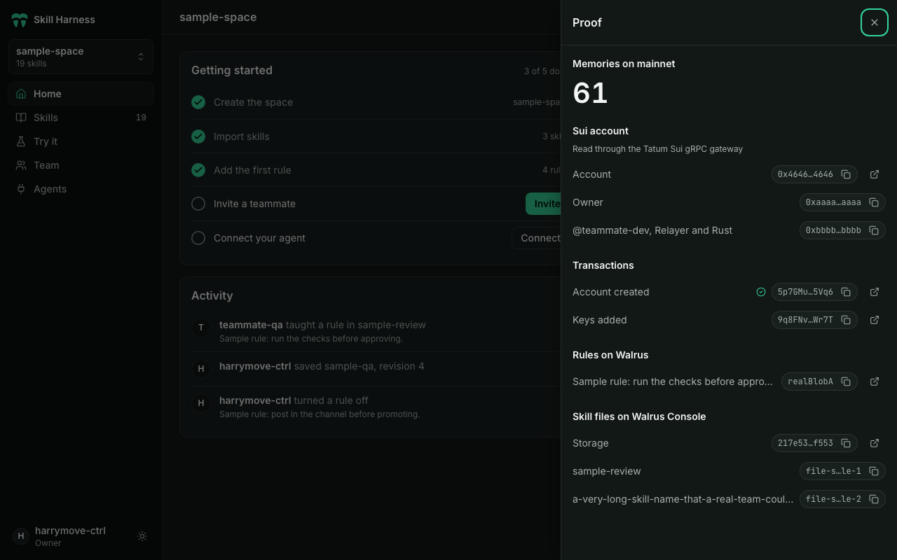
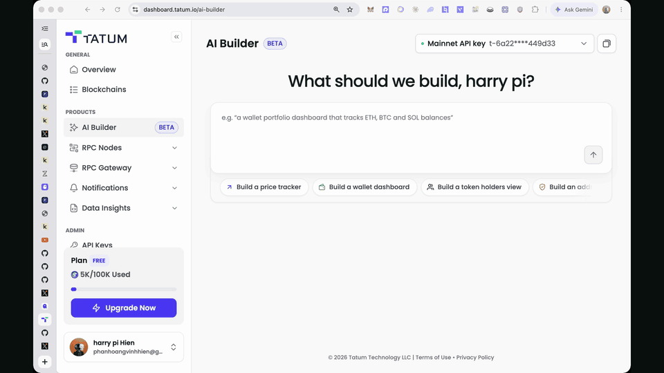
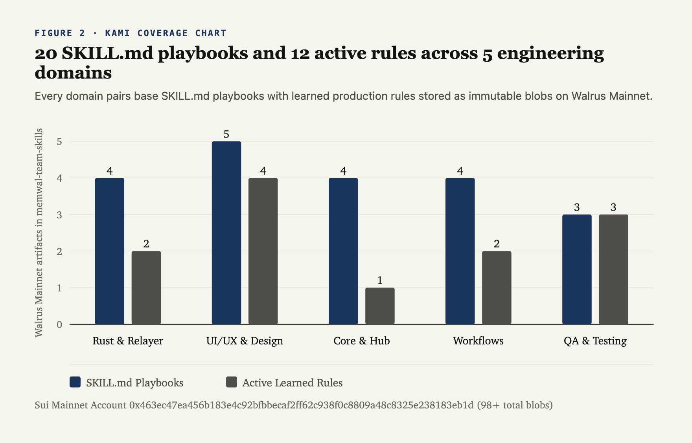

# Skillbook: Teach a Rule Once, and Every Coding Agent on Your Team Follows It



1. **Live App**: https://memwal-skill-harness-production.up.railway.app
2. **Demo Video (2:56 YouTube)**: https://youtu.be/65Ky7_SXOZ0
3. **Tatum AI Builder App**: https://dashboard.tatum.io/ai-builder/skillbook-mcp-rust-pattern-analyz-31177f?productId=6a228877df9fc562405f2e04&chat=ses_e3b4143bbffejlA8wivSsQKoJW
4. **GitHub Repository**: https://github.com/harrymove-ctrl/memwal-skill-harness

## 1. Why Coding Agents Keep Repeating Yesterday's Bugs

Look at how a software team actually writes code during a sprint. One engineer runs Claude Code in the terminal to refactor a Rust backend. A second engineer uses Cursor to build React components. A third runs Codex or Antigravity across parallel git worktrees to write integration tests. Meanwhile, the team prototypes on-chain dashboards inside Tatum AI Builder (`https://dashboard.tatum.io/ai-builder`).

Every one of those five agents starts with the same blind spot: none of them knows what broke in production yesterday unless someone manually copies that lesson into five different config files.

During our own development on Walrus and Sui, we watched the exact same bugs come back across different teammates' agents within 24 hours:

1. **Tokio Mutex Deadlocks**: A Rust agent held a synchronous `std::sync::MutexGuard` across an `.await` call inside a Tokio handler, blocking the worker thread under concurrent load.
2. **Swapped String IDs**: Another agent generated a storage helper that accepted two plain `String` parameters (`blob_id: String, sui_object_id: String`), and a caller passed them in reverse order.
3. **Dark Mode Contrast Regressions**: A frontend agent added a WebGL highlight shader at full `1.0` brightness in dark mode, washing out white text on dark cards.
4. **Unbounded API Polling**: A dashboard script polled Tatum's v4 exchange rate endpoint on every React render instead of caching the response, threatening to burn through our 100,000 free-tier credit allowance.

Fixing a bug in one chat thread or updating a local `.cursorrules` file on one laptop does not fix the team. Exporting `.zip` folders of `SKILL.md` files goes stale the moment someone edits a rule.

We built **Skillbook** (`https://memwal-skill-harness-production.up.railway.app`) for the `@WalrusProtocol` x `@tatum_io` Total Recall hackathon to close that gap. Skillbook gives your team one shared rulebook stored on Walrus Mainnet, gated on Sui, and verified with Tatum. When you teach a rule once, every connected coding agent recalls and enforces it in 38 milliseconds.



## 2. How You Check, Test, and Release a Skill Before Your Agents Use It

Sharing rules across five coding agents only works if you verify each rule before it goes live. If a developer writes a vague or conflicting instruction and pushes it straight to every agent on the team, five agents start writing broken code at once.

Skillbook treats engineering rules and `SKILL.md` playbooks like software releases, with an explicit test step in `/try` before publication and a one-click rollback on `/home` afterwards.



Every rule moves through four concrete stages:

1. **Capture the lesson from a real bug**: When you fix a failure in Rust, TypeScript, UI layout, or CI verification, you write a concise rule (one sentence stating what to do and one sentence stating why) and link it to its parent skill (`rust-async-patterns`, `rust-patterns`, `ui-ux-qa`, `memwal-qa`).
2. **Test the behavioral impact in `/try`**: Before publishing the rule to the team, you open `/try` and run a real coding prompt. Skillbook executes a live recall against Walrus Mainnet and shows two code panels side by side: the baseline output without team rules on the left, and the corrected output with your rule applied on the right, complete with the exact Walrus blob ID receipt.
3. **Publish or bake into the parent `SKILL.md`**: Once the diff looks right, you publish the rule to the `memwal-team-skills` namespace. When a rule proves itself over time and belongs permanently inside the base skill document, clicking **Bake** (`POST /api/ns/:ns/rules/:ruleId/bake`) appends the rule into the parent `SKILL.md` under `## Team Rules (Synced from Walrus)`, writes a new skill revision blob to Walrus Mainnet, and turns the standalone rule toggle off so agents never read duplicate instructions.
4. **Pause noisy rules in one click**: If a rule causes unexpected side effects on a new codebase, any authorized teammate can toggle it from `on` to `off` on `/home`. Skillbook records a new state blob on Walrus Mainnet and removes the rule from active agent recalls immediately while keeping the full revision history on Walruscan.



## 3. Making Immutable Walrus Blobs Respond in 38 Milliseconds

Building a live rulebook on top of decentralized blob storage exposed an immediate architectural tension. Walrus Mainnet blobs are immutable by design, and sealing a new blob on Mainnet takes 4 to 8 seconds. At the same time, coding agents expect their context and rules to load in tens of milliseconds.

When we first connected Tatum AI Builder (`https://dashboard.tatum.io/ai-builder`) to our backend, our server queried the Walrus relayer sequentially on every incoming request: first listing namespace metadata, then running prefix recall searches for skills and rules, and finally querying Tatum's API. On a cold start, that sequence took `7,400 milliseconds`. Because Tatum AI Builder's Envoy preview proxy enforces a `5,000 millisecond` upstream timeout, the proxy cut the connection and returned a plain-text error (`upstream request timeout`), which crashed the preview's JSON parser with `Unexpected token 'u'`.



We solved both immutability and latency by designing an append-only version-folding layer (`server/memoryGateway.mjs`) on top of Walrus Mainnet:

1. **Typed Append-Only Event Blobs**: Every change is written as a new immutable blob under Sui Mainnet Account `0x463ec47ea456b183e4c92bfbbecaf2ff62c938f0c8809a48c8325e238183eb1d` using `@mysten-incubation/memwal` (`rememberBulk`): `[SKILL:<name>]` for full playbooks, `[RULE:<id>]` and `[FLOW:<skill>]` for learned rules, `[RULE_STATE:<id>]` for enable and disable toggles, and `[AGENT_LOG:RECALL]` for agent recall receipts.
2. **Chronological In-Memory Folding**: On server boot and during background refreshes, Skillbook reads the namespace's blobs from Walrus Mainnet and folds them by timestamp (`created_at`). If a rule was created at 10:00, edited at 10:15, and toggled off at 10:30, the folded snapshot reflects the 10:30 state while keeping all three Walrus blob IDs in the revision trail.
3. **Optimistic Concurrency via `If-Match`**: Every skill and rule carries a revision counter (`v1`, `v2`, `v3`) derived from its Walrus blob history. Update requests must include an `If-Match` header matching the current revision; if two teammates edit the same rule at once, the stale write fails with HTTP `409 Conflict` instead of silently overwriting a colleague's rule.
4. **38 Millisecond Recall**: Because the active rule snapshot is pre-warmed in memory and refreshed asynchronously after writes, `GET /api/tatum-memwal/recall` responds in `38 milliseconds`, well inside Tatum AI Builder's 5-second proxy limit.

## 4. Sui Sign-In, Tatum Mainnet RPC, and Tatum v3 Security

A team rulebook should not leak internal engineering rules or wallet addresses to anonymous visitors on the public web.

When you open Skillbook signed out, the app renders only the public landing page. To enter the `memwal-team-skills` workspace, a teammate signs one gas-free personal message using either **Slush Wallet** or **Google (`@mysten/enoki` Sui Mainnet zkLogin)**.



Once signed in, Skillbook verifies the workspace's on-chain state and protects team access using three Tatum services:

1. **Tatum Sui Mainnet RPC (`https://sui-mainnet.gateway.tatum.io`)**: Skillbook queries Tatum's Sui Mainnet RPC gateway to read the live `MemWalAccount` object, verify the workspace owner address (`0x8a2572a955f053a9f7859477b5ecae3c81391901da5e174046c7bb67f98ee124`), and inspect registered Ed25519 delegate keys in `/team` and the `Proof` drawer.
2. **Tatum v3 Security API (`GET /v3/security/address/{address}`)**: Before granting a wallet access to the namespace or registering a new delegate key, Skillbook screens the Sui address against Tatum's v3 Security endpoint for OFAC sanctions and phishing flags.
3. **Tatum v4 Data API (`GET /v4/data/rate/symbol?symbol=SUI&basePair=USD`)**: Skillbook pairs its on-chain storage metrics with live SUI/USD pricing (`\$0.8397` via CoinGecko on Tatum v4) and caches the result on the server for 30 minutes so agent recalls never exhaust free-tier credits (`4,703` of `100,000` credits used).

## 5. Running Live Inside Tatum AI Builder (`dashboard.tatum.io/ai-builder`)

Local CLI agents and browser-based cloud builders have different security constraints, so Skillbook supports both without exposing private keys.

For local harnesses running on a developer's laptop (Claude Code, Cursor, Codex, and Antigravity), `/agents` generates a one-line `@mysten-incubation/memwal-mcp` command. The Ed25519 delegate key (`$MEMWAL_PRIVATE_KEY`) stays in the developer's local shell environment and is never sent to a browser.

For cloud builders like **Tatum AI Builder** (`https://dashboard.tatum.io/ai-builder`), Skillbook exposes an OpenAPI-documented bridge (`/api/tatum-memwal/recall`, `/api/tatum-memwal/mcp`, and `/api/tatum-memwal/openapi.json`) that strips internal storage prefixes and returns clean rule titles, rationales, Walruscan links, Tatum security status, and before-and-after code examples.



Inside Tatum AI Builder (`Skillbook MCP Rust Pattern Analyzer`), a single prompt connected to our Railway endpoint, recalled all 12 active rules from `memwal-team-skills`, verified our Sui owner address (`0x8a2572...e124`) via Tatum v3 Security (`Valid / Non-Malicious`), fetched the live SUI/USD rate (`\$0.8397`), and rendered the side-by-side Tokio handler code transformation:

```rust
// BEFORE (Baseline without Walrus Memory):
// Holding std::sync::MutexGuard across .await blocks the Tokio worker thread
// and accepts raw String IDs that callers can accidentally swap.
pub async fn sync_walrus_blob(
    state: Arc<std::sync::Mutex<SyncState>>,
    blob_id: String,
    sui_object_id: String,
) -> Result<(), String> {
    let mut guard = state.lock().unwrap();
    guard.inflight += 1;
    let payload = fetch_walrus_blob(&blob_id).await.unwrap();
    guard.completed.push((sui_object_id, payload.len()));
    Ok(())
}

// AFTER (Guided by Skillbook Rules recalled from Walrus Mainnet in 38ms):
// 1. [flow-rust-newtype-ids] Distinct WalrusBlobId & SuiObjectId newtypes
// 2. [flow-rust-mutex-await] Lock scoped and dropped BEFORE .await
#[derive(Debug, Clone, PartialEq, Eq, Hash)]
pub struct WalrusBlobId(pub String);

#[derive(Debug, Clone, PartialEq, Eq, Hash)]
pub struct SuiObjectId(pub String);

pub async fn sync_walrus_blob(
    state: Arc<std::sync::Mutex<SyncState>>,
    blob_id: WalrusBlobId,
    sui_object_id: SuiObjectId,
) -> Result<(), SyncError> {
    {
        let mut guard = state.lock().map_err(|_| SyncError::StatePoisoned)?;
        guard.inflight += 1;
    } // MutexGuard dropped here before .await

    let payload = fetch_walrus_blob(blob_id.0.as_str()).await?;

    {
        let mut guard = state.lock().map_err(|_| SyncError::StatePoisoned)?;
        guard.inflight = guard.inflight.saturating_sub(1);
        guard.completed.push((sui_object_id, payload.len()));
    }
    Ok(())
}
```

## 6. How Skillbook Learned Over Time: 20 Playbooks and 12 Mainnet Rules

Over the course of building Skillbook, our `memwal-team-skills` namespace grew to `98+` Mainnet blobs spanning 20 complete `SKILL.md` playbooks and 12 active production rules across five engineering domains:



Here are sample Walruscan Mainnet blob receipts you can inspect directly on-chain:

1. **Sui Mainnet Owner Address**: https://suiscan.xyz/mainnet/account/0x8a2572a955f053a9f7859477b5ecae3c81391901da5e174046c7bb67f98ee124
2. **MemWal Account Object on Sui Mainnet**: https://suiscan.xyz/mainnet/object/0x463ec47ea456b183e4c92bfbbecaf2ff62c938f0c8809a48c8325e238183eb1d
3. **`rust-async-patterns` Playbook Blob**: https://walruscan.com/mainnet/blob/qAef393b9C2vT-rWR-bR28c_a3cYDPb8a3gZ6_h4N5w
4. **`rust-patterns` Playbook Blob**: https://walruscan.com/mainnet/blob/38uB9dF4q2T_5e7rW8xZ1mN0pL6kY2vH9jG4cB1vX3s
5. **Rule `flow-rust-mutex-await` Blob**: https://walruscan.com/mainnet/blob/gs0M1js80k-O_WvkYt7v08phKe3KC8PBINIOPowo7G-0
6. **Rule `flow-rust-newtype-ids` Blob**: https://walruscan.com/mainnet/blob/z7BHX3brsgqcmDQXh2IzmoCj4g14XioezjkuIL1Fkk0
7. **Rule `flow-tatum-rate-cache` Blob**: https://walruscan.com/mainnet/blob/r8M5K2pL9vX3cZ7bN1qW4eR6tY8uI0oP3aS5dF7gH9j

## 7. Try Skillbook Live

1. **Web App (`Skillbook`)**: https://memwal-skill-harness-production.up.railway.app
2. **Full 2:56 Demo Video (YouTube)**: https://youtu.be/65Ky7_SXOZ0
3. **Tatum AI Builder Live App**: https://dashboard.tatum.io/ai-builder/skillbook-mcp-rust-pattern-analyz-31177f?productId=6a228877df9fc562405f2e04&chat=ses_e3b4143bbffejlA8wivSsQKoJW
4. **Full Technical Blog Post & Source Code on GitHub**: https://github.com/harrymove-ctrl/memwal-skill-harness/blob/main/docs/SUBMISSION_BLOG_POST.md
