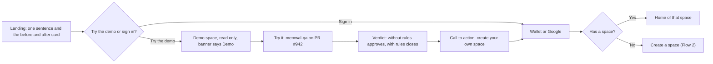
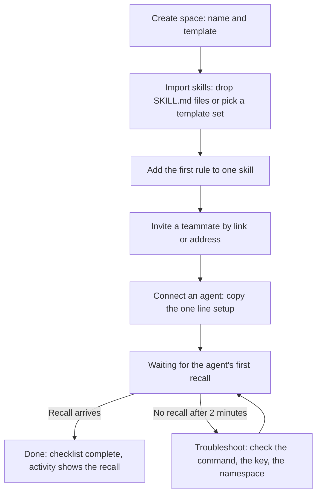
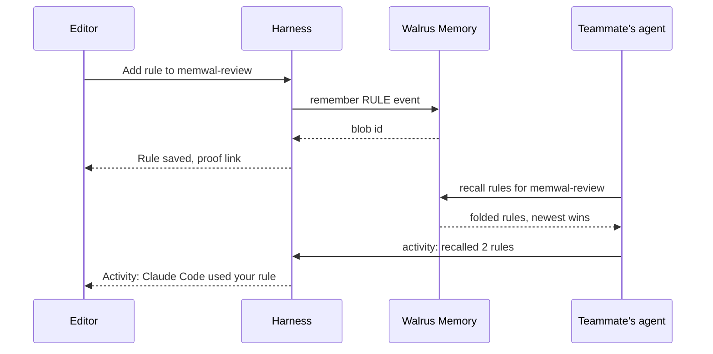
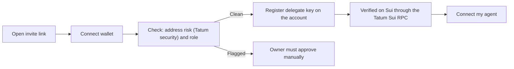
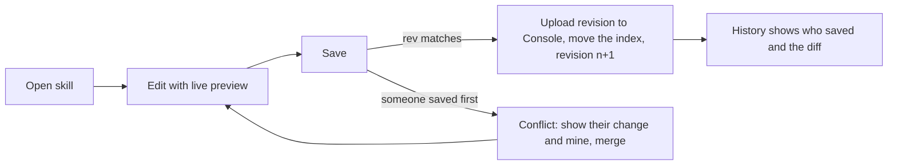
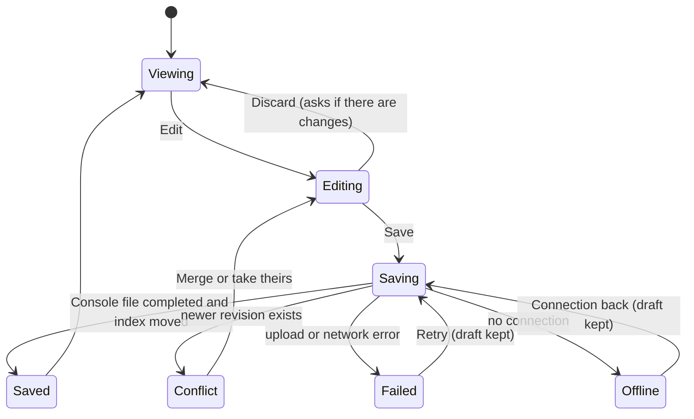
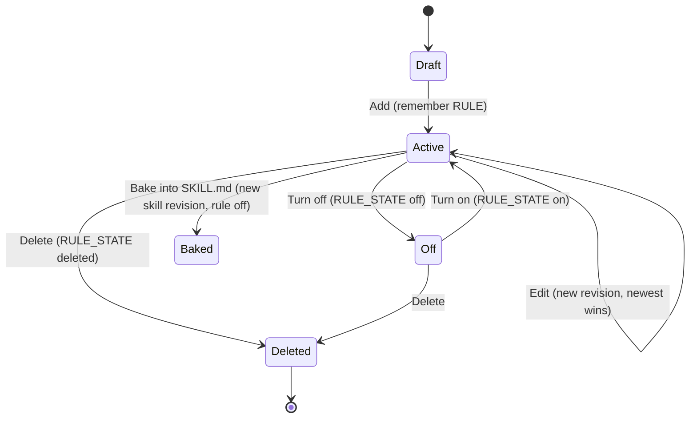

# 3. User flows and state machines

Each flow names its goal, its happy path, and where it can fail. The diagrams are the target behavior, not today's.

## Flow 1. A visitor understands the product and tries it

Goal: in under 30 seconds, a visitor sees a real decision change because of a team rule, without signing in.

Failure points: the demo must never ask for a wallet; a failed relayer call shows the recorded result with a "recorded" label instead of an error wall.

## Flow 2. An owner sets up a space until the first recall

Goal: reach activation (one teammate, one agent, one recall) in under 5 minutes.

The Home checklist mirrors these five steps, each with its own button, and ticks itself from real events.

## Flow 3. Teach once, every agent follows

Goal: a rule written by one person (or learned by one agent) changes the next run of every teammate's agent.

The last arrow is what makes the product feel alive: the author sees their rule being used.

## Flow 4. A teammate joins

## Flow 5. Edit a skill

## State machine: saving a skill

Rules for this machine: the Save button is disabled while saving; the draft survives a reload until it is saved; "Saved" appears only after the Console reports completed; every failure keeps the draft and offers Retry.

## State machine: a rule's life

Every transition is a new event in Walrus Memory, because the store cannot delete. The UI shows the folded state; the history shows the events.

## Screen states every view must handle

| State | What the user sees |
| :--- | :--- |
| Loading | Skeletons in the content's own shape, never a spinner over a blank page |
| Empty | One sentence on what goes here and one button to fill it (for example "No rules yet. Add the first thing your team learned.") |
| Error | What failed in plain words, what was kept, and a Retry button |
| Offline | A banner; edits keep working as drafts and sync when back |
| Read only | Edit controls hidden, a small "Viewer" pill in the header |
| Demo | A persistent "Demo space" banner with "Create your own" |
