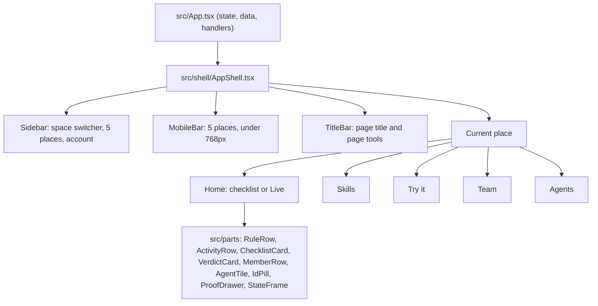

# 7. Build plan: the dark command center

How to turn the plan into code between Wednesday 4 and Monday 9 November 2026, in the order that keeps the app working every evening. Each step names its files, what it depends on, and when it is done.

## Ground rules

1. **No secrets in the client.** `npm run build` runs `scripts/check-bundle-secrets.mjs`; a step is not done if it fails.
2. **Antigravity owns `src/App.tsx` for the whole build (decided 3 Nov).** Claude never edits it. Claude builds the shell, parts and places as new files under `src/shell/`, `src/parts/` and `src/places/`, each driven only by props; Antigravity wires them into `App.tsx`. The contract between the two is `handoff-antigravity.md`.
3. **Other shared files go one agent at a time.** `src/index.css`, `vite.config.ts` and `server/*.mjs` are claimed per step in the Owner column below; anything not listed is agreed in chat first.
4. **Git first.** The folder is not a repository yet, and the Claude Code sandbox cannot create `.git`. Run the baseline commands in Step 0 from a normal terminal before any code change, so every step can be reviewed and undone.
5. **Every step ends with the audit:** `node video/scripts/audit-ui.mjs` against the targets in `04-screens.md`, plus the screenshots it writes.

## What exists today

| Area | Where | Notes |
| :--- | :--- | :--- |
| Routes | `src/App.tsx`, `PRIMARY_ROUTES` (line 155), `currentPath` | `/eval` Playground, `/graph` Skills, `/cad` Connect, `/bento`, `/` landing |
| Header | `src/App.tsx`, about lines 1627 to 2124 | Brand, bucket chip, tabs, space dropdown, share, account, theme toggle |
| Theme | `isDark` state and the `dark` class on `<html>`; Tailwind 4 `@custom-variant dark` in `src/index.css` | Light is the default today |
| Skills API | `server/namespaceSkillsApi.mjs` | `/api/ns/:ns/skills`, `/skills/:id`, `/rules`, `/rules/:id/state`, `/rules/:id/bake` |
| Console | `server/consoleGateway.mjs` | Runs the official Console MCP; local index cache in `server/console-bucket-index.json` |
| Rules | `server/memoryGateway.mjs` | Event log fold, newest wins |
| Activity | `server/tatumMemwalApi.mjs`, `GET /api/tatum-memwal/activity` | `[AGENT_LOG]` memories |

## Shell structure



`App.tsx` keeps its state and handlers and passes them down; the shell owns layout only. That keeps the hook up in `App.tsx` small.

## Steps

| Step | Day | Owner | Work | Files | Done when |
| ---: | :--- | :--- | :--- | :--- | :--- |
| 0 | Wed 4 | You | Git baseline | `.gitignore` (media already excluded) | One commit by `harrymove-ctrl` |
| 1 | Wed 4 | Claude | Dark tokens as the default | `src/shell/tokens.css`, `src/shell/theme.ts`; one import line in `src/index.css` | Tokens from `05-design-system.md`; dark by default in the preview and, after step 3, in the app; the toggle still switches to light |
| 2 | Wed 4 | Claude | `AppShell`, `Sidebar`, `MobileBar`, `TitleBar` | `src/shell/*.tsx` | Renders the five places from props; selected state; 0px overflow at 390px; bottom bar under 768px |
| 3 | Wed 4 | Antigravity | Wrap the app in `AppShell`, remove the old header, add routes | `src/App.tsx` using `src/shell/places.ts` | `/home`, `/skills`, `/try`, `/team`, `/agents`; old `/graph`, `/eval`, `/cad` redirect; signed in users land on `/home` |
| 4 | Wed 4 | Both | Vocabulary pass | Claude: `src/shell/copy.ts` and new files. Antigravity: strings left in `src/App.tsx` | No "Bucket", "Fact", "Plan gate" or "Bake" in primary copy |
| 5 | Thu 5 | Claude, then Antigravity | Home before activation | Claude: `src/places/Home.tsx`, `ChecklistCard`, `VerdictCard`. Antigravity: pass real counts from `App.tsx` | Checklist ticks from real data |
| 6 | Thu 5 | Claude, then Antigravity | Live view | Claude: `src/places/Live.tsx`, `ActivityRow`, a `useActivity` hook calling `/api/tatum-memwal/activity`. Antigravity: mount it on `/home` after activation | Counts today's real recall events |
| 7 | Thu 5 | Claude, then Antigravity | Skills restyle, persisted rules | Claude: `src/places/Skills.tsx`, `RuleRow`, a `useRules` hook on `/api/ns/:ns/rules`. Antigravity: swap the old Skills view | Rule switches survive reload; document on the raised surface |
| 8 | Fri 6 | Claude, then Antigravity | Team with the Tatum Sui RPC | Claude: `src/places/Team.tsx`, `MemberRow`, `server/tatumSuiGateway.mjs` and its route. Antigravity: mount it | Keys read through Tatum; address check before Add; no auto registration |
| 9 | Fri 6 | Claude, then Antigravity | Agents with live status | Claude: `src/places/Agents.tsx`, `AgentTile`. Antigravity: mount it | Status from each agent's last recall |
| 10 | Sat 7 | Claude, then Antigravity | Landing, demo space, Try it | Claude: `src/places/Landing.tsx`, `TryIt.tsx`. Antigravity: signed out routing and the demo space flag | Verdict in 30 seconds without a wallet |
| 11 | Sun 8 | Claude | Proof drawer and screen states | `ProofDrawer.tsx`, `StateFrame.tsx` | Every state reachable with `?state=` |
| 12 | Sun 8 | Claude | QA pass | `video/scripts/audit-ui.mjs` extended to the new routes | All audit targets met on desktop and mobile |

"Claude, then Antigravity" means Claude ships the component with its props and a short note in `handoff-antigravity.md`; Antigravity mounts it in `App.tsx` and passes the data.

## Step 0 commands (run in a normal terminal)

```bash
cd /Volumes/Dev/memwal-skill-harness
~/.agents/skills/github-identity-guard/scripts/enforce-github-identity.sh
git init -b main
git add -A
git commit -m "Baseline before the dark command center shell"
```

Check `git status` afterwards: no `.env*`, `*.mp4`, `*.wav` or `out/` files should be staged. A secret scan of every file that would be tracked found none on 3 Nov.

## Open questions, settled on 6 Nov

1. **Which protocol Tatum's Sui gateway speaks.** Native gRPC, at `sui-mainnet-grpc.gateway.tatum.io`, with the key in an `x-api-key` header. It answers `application/grpc`, so the SDK's default gRPC-web transport fails with "unexpected response content type". `server/tatumSuiGateway.mjs` gives `SuiGrpcClient` a small unary transport over `node:http2`, with no new dependency. The gateway rate limits within about three quick calls, so calls run one at a time, 450ms apart, retry once and are cached for 30 minutes. A read of the real account, a balance, a SuiNS name and a transaction were all confirmed through it.
2. **Where agent recalls are logged.** Nothing logged them. Now there are three ways, all in the format the screens read: the Agents place gives each agent an instruction to paste, `POST /api/ns/:ns/recalls` lets a member's tool log one, and `POST /api/tatum-memwal/recall` logs when the caller is a member and names its agent. Each log is a paid mainnet write, so the server writes at most one per agent and skill every five minutes. The `memwal-skill-hub` skill still needs the text below, and changing it is the owner's call: the local copy is write protected for agents, and the team copy is a mainnet write.

Add this to `memwal-skill-hub`, after the step that calls `memwal_recall`:

```text
After you recall team rules, save one memory with memwal_remember:
[AGENT_LOG:RECALL] [agent:<your agent id>] [author:@<your handle>] [target:<skill name>] [rules:<how many rules you used>]
Save it once per skill per task. Agent ids are claude-code, cursor, codex, antigravity and tatum-ai. Never put secrets, code or customer data in it.
```

## Problems found while reading the real API

| Problem | Where | Why it matters | State on 6 Nov |
| :--- | :--- | :--- | :--- |
| Anyone can write when no caller is sent, and the caller and role are plain headers | `verifyWriteAllowlist` in `server/namespaceSkillsApi.mjs` | A stranger can change or delete skills and rules, and spend mainnet funds | Fixed. A wallet signs a one time message, and `server/auth.mjs` sets an HttpOnly session cookie. Roles come from the member list and the chain. The headers are ignored |
| Anyone could add themselves as an Owner | `POST /api/tatum-memwal/acl` had no check | Full takeover of a space's member list | Fixed. Owners only. **The live list should still be checked for anyone added this way** |
| Anyone could register by asking, even for write access | `POST /api/tatum-memwal/verify-access` | Spec says nobody is auto registered | Fixed. Joining takes an invite signed by the server, made by an owner, good for 7 days |
| Anyone could spend funds through the bridge | `/remember`, `/create-collection`, `/chat`, and the MCP write tools | Paid mainnet writes with no identity | Fixed. These need a member who can write, or `MEMWAL_BRIDGE_API_KEY` |
| The address check passes when Tatum is down | `screenSuiAddressCached` in `server/tatumMemwalApi.mjs` | An outage reads as "valid" | Fixed for Team: `screenAddress` in the new gateway returns unknown, and adding then takes a stated choice. The old function remains for the older MCP tool |
| Rule reads never come from Walrus | `listFoldedRules` in `server/memoryGateway.mjs` | A redeploy forgets new rules and switches | Fixed. The first read rebuilds from Walrus Memory, waiting at most 3 seconds and finishing in the background. It reads the newest 100 matches, so a very long history may not come back whole |
| Writes report failure after 1.8 seconds, and job ids were stored as blob ids | `upsertRule` and `setRuleState` | A job id is not proof, and a slow write looked failed | Fixed. `writeEvent` waits for the stored result, and records the real blob id whenever it lands |
| Placeholder blob ids look like proof | `DEFAULT_BLOBS` in `server/consoleGateway.mjs`, the literal in `memoryGateway.mjs` | They must not be presented as evidence | Fixed. The Proof drawer filters them on the server and in the browser |
| Test data sits in the real space | `e2e-rule-*`, `rule-memwal-qa-*` and repeated switches | The store cannot delete | Open. Set `VITE_DEMO_NAMESPACE` to a clean space for the video |
| The member list disagrees with the chain | The list says `@harrymove-ctrl` at `0x649e…4be1` is the owner; the account's on-chain owner is `0x8a25…e124`, listed as `@mysten-dev` | Team shows the first as Pending. The on-chain owner is always treated as an owner | Open; the owner must decide which address is theirs |
| Reads are public, including decrypted recall | Every GET, and `POST /api/tatum-memwal/recall` | The server decrypts for anyone who asks, which the "SEAL protected" wording does not suggest | Open; the demo depends on it |
| `/tatum-api` adds the Tatum key for anyone | `server.mjs`, `vite.config.ts` | Anyone can spend Tatum credits through it | Open |
| Google sign in cannot prove identity | `connectEnokiGoogleZkLogin` signs with a throwaway key, and `/enoki-api/v1/zklogin/session` takes a typed email | The session check refuses both, so the new sign in offers wallets only | Open; needs a real zkLogin proof flow |
| `/api/tatum-memwal/sponsor` | `server/tatumMemwalApi.mjs` | It spends sponsored gas | Not reviewed |

## What was built differently on 6 Nov

Steps 3 and 8 to 12 are built, and the wiring went a different way from the table above. `src/App.tsx` was not edited. `src/Root.tsx` now mounts `src/CommandCenter.tsx`, which holds routing, session and data for every place, and the older app keeps only `/bento` and `?legacy=1`.

| Planned | What shipped | Why |
| :--- | :--- | :--- |
| Try it runs a live agent, with a Recorded fallback | Plans are written examples, labelled on every screen. The rules and the switch between plans are real: turning the rule off in Skills changes the result | No model key exists in this project. The older screen showed the same kind of text with no label |
| Editable task text | The task is shown, not typed | Editing it could not change a written example, so a field would mislead |
| Real agent logos | A plain icon and the agent's name | No licensed logo files exist here |
| Agent disconnect, New space | Not built | Disconnect means removing a key on chain; it was first on the cut list. New space is a mainnet write |
| `?state=` on every route | On the preview only | A production page should not pretend to be broken for anyone with the link |

## Risks

| Risk | Mitigation |
| :--- | :--- |
| Two agents edit `App.tsx` at once | New files first, one hook up, file ownership agreed per step |
| Dark makes long documents tiring | `raised` reading surface, `ink` body text, 68 character measure |
| Live view is empty in the demo | Seed real recalls before recording: run two agents on the demo space |
| Tatum Sui gateway protocol mismatch | Settle the open question first; fall back to Tatum for address checks only and say so in the README |
