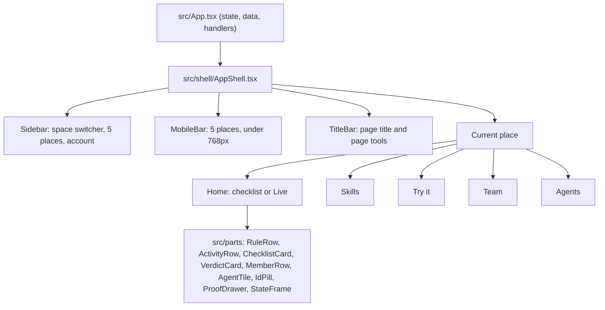

# 7. Build plan: the dark command center

How to turn the plan into code between Wednesday 4 and Monday 9 November 2026, in the order that keeps the app working every evening. Each step names its files, what it depends on, and when it is done.

## Ground rules

1. **No secrets in the client.** `npm run build` runs `scripts/check-bundle-secrets.mjs`; a step is not done if it fails.
2. **Antigravity owns `src/App.tsx` for the whole build (decided 3 Nov).** Claude never edits it. Claude builds the shell, parts and places as new files under `src/shell/`, `src/parts/` and `src/places/`, each driven only by props; Antigravity wires them into `App.tsx`. The contract between the two is `handoff-antigravity.md`.
3. **Other shared files go one agent at a time.** `src/index.css`, `vite.config.ts` and `server/*.mjs` are claimed per step in the Owner column below; anything not listed is agreed in chat first.
4. **Git first.** The folder is not a repository yet, and the Claude Code sandbox cannot create `.git`. Run the baseline commands in Step 0 from a normal terminal before any code change, so every step can be reviewed and undone.
5. **Every step ends with the audit:** `node video/scripts/audit-ui.mjs` against the targets in `04-screens.md`, plus the screenshots it writes.

## What exists today

| Area | Where | Notes |
| :--- | :--- | :--- |
| Routes | `src/App.tsx`, `PRIMARY_ROUTES` (line 155), `currentPath` | `/eval` Playground, `/graph` Skills, `/cad` Connect, `/bento`, `/` landing |
| Header | `src/App.tsx`, about lines 1627 to 2124 | Brand, bucket chip, tabs, space dropdown, share, account, theme toggle |
| Theme | `isDark` state and the `dark` class on `<html>`; Tailwind 4 `@custom-variant dark` in `src/index.css` | Light is the default today |
| Skills API | `server/namespaceSkillsApi.mjs` | `/api/ns/:ns/skills`, `/skills/:id`, `/rules`, `/rules/:id/state`, `/rules/:id/bake` |
| Console | `server/consoleGateway.mjs` | Runs the official Console MCP; local index cache in `server/console-bucket-index.json` |
| Rules | `server/memoryGateway.mjs` | Event log fold, newest wins |
| Activity | `server/tatumMemwalApi.mjs`, `GET /api/tatum-memwal/activity` | `[AGENT_LOG]` memories |

## Shell structure



`App.tsx` keeps its state and handlers and passes them down; the shell owns layout only. That keeps the hook up in `App.tsx` small.

## Steps

| Step | Day | Owner | Work | Files | Done when |
| ---: | :--- | :--- | :--- | :--- | :--- |
| 0 | Wed 4 | You | Git baseline | `.gitignore` (media already excluded) | One commit by `harrymove-ctrl` |
| 1 | Wed 4 | Claude | Dark tokens as the default | `src/shell/tokens.css`, `src/shell/theme.ts`; one import line in `src/index.css` | Tokens from `05-design-system.md`; dark by default in the preview and, after step 3, in the app; the toggle still switches to light |
| 2 | Wed 4 | Claude | `AppShell`, `Sidebar`, `MobileBar`, `TitleBar` | `src/shell/*.tsx` | Renders the five places from props; selected state; 0px overflow at 390px; bottom bar under 768px |
| 3 | Wed 4 | Antigravity | Wrap the app in `AppShell`, remove the old header, add routes | `src/App.tsx` using `src/shell/places.ts` | `/home`, `/skills`, `/try`, `/team`, `/agents`; old `/graph`, `/eval`, `/cad` redirect; signed in users land on `/home` |
| 4 | Wed 4 | Both | Vocabulary pass | Claude: `src/shell/copy.ts` and new files. Antigravity: strings left in `src/App.tsx` | No "Bucket", "Fact", "Plan gate" or "Bake" in primary copy |
| 5 | Thu 5 | Claude, then Antigravity | Home before activation | Claude: `src/places/Home.tsx`, `ChecklistCard`, `VerdictCard`. Antigravity: pass real counts from `App.tsx` | Checklist ticks from real data |
| 6 | Thu 5 | Claude, then Antigravity | Live view | Claude: `src/places/Live.tsx`, `ActivityRow`, a `useActivity` hook calling `/api/tatum-memwal/activity`. Antigravity: mount it on `/home` after activation | Counts today's real recall events |
| 7 | Thu 5 | Claude, then Antigravity | Skills restyle, persisted rules | Claude: `src/places/Skills.tsx`, `RuleRow`, a `useRules` hook on `/api/ns/:ns/rules`. Antigravity: swap the old Skills view | Rule switches survive reload; document on the raised surface |
| 8 | Fri 6 | Claude, then Antigravity | Team with the Tatum Sui RPC | Claude: `src/places/Team.tsx`, `MemberRow`, `server/tatumSuiGateway.mjs` and its route. Antigravity: mount it | Keys read through Tatum; address check before Add; no auto registration |
| 9 | Fri 6 | Claude, then Antigravity | Agents with live status | Claude: `src/places/Agents.tsx`, `AgentTile`. Antigravity: mount it | Status from each agent's last recall |
| 10 | Sat 7 | Claude, then Antigravity | Landing, demo space, Try it | Claude: `src/places/Landing.tsx`, `TryIt.tsx`. Antigravity: signed out routing and the demo space flag | Verdict in 30 seconds without a wallet |
| 11 | Sun 8 | Claude | Proof drawer and screen states | `ProofDrawer.tsx`, `StateFrame.tsx` | Every state reachable with `?state=` |
| 12 | Sun 8 | Claude | QA pass | `video/scripts/audit-ui.mjs` extended to the new routes | All audit targets met on desktop and mobile |

"Claude, then Antigravity" means Claude ships the component with its props and a short note in `handoff-antigravity.md`; Antigravity mounts it in `App.tsx` and passes the data.

## Step 0 commands (run in a normal terminal)

```bash
cd /Volumes/Dev/memwal-skill-harness
~/.agents/skills/github-identity-guard/scripts/enforce-github-identity.sh
git init -b main
git add -A
git commit -m "Baseline before the dark command center shell"
```

Check `git status` afterwards: no `.env*`, `*.mp4`, `*.wav` or `out/` files should be staged. A secret scan of every file that would be tracked found none on 3 Nov.

## Open questions to settle before Step 8

1. **Which protocol Tatum's Sui gateway speaks.** Sui's JSON-RPC was switched off in 2026 and the app reads Sui over gRPC. Confirm whether Tatum's Sui mainnet gateway serves gRPC (or GraphQL) before building member verification on it, and what its rate limits are.
2. **Where agent recalls are logged (checked 4 Nov: nothing logs them).** The newest 40 memories in the real space hold no `[AGENT_LOG]` entries, and the code only writes `LEARN_RULE`, `CREATE_NAMESPACE` and `TASK_EXECUTION`. Without a recall event, the checklist never finishes and Live never appears. The screens read this format: `[AGENT_LOG:RECALL] [agent:claude-code] [author:@handle] [target:memwal-qa] [rules:2]`. The `memwal-skill-hub` skill must tell agents to write it after each recall.

## Problems found on 4 Nov while reading the real API

| Problem | Where | Why it matters | State |
| :--- | :--- | :--- | :--- |
| Anyone can write when no caller is sent | `verifyWriteAllowlist` in `server/namespaceSkillsApi.mjs` returns allowed for an empty caller, and the caller and role are plain headers | A stranger can change or delete skills and rules on the deployed app, and spend its mainnet funds | Open; needs signed requests |
| Skill delete has the same gap, and rule state and rule write to SKILL.md had no check at all | Same file | A Viewer could change rules through the API | State and write to SKILL.md now check, with a test; the empty caller gap above still applies |
| Rule reads never come from Walrus | `listFoldedRules` in `server/memoryGateway.mjs` reads `/tmp/memwal-ns-rules-state-v1.json` plus seeds | A redeploy forgets new rules and switches, which contradicts "team rules live in Walrus Memory" and step 7's "survive reload" past a redeploy | Open; needs a rebuild from Walrus on cold start |
| Writes report failure after 1.8 seconds | The `Promise.race` timeout in `upsertRule` and `setRuleState` | The rule keeps a placeholder blob id, so the UI says "not on Walrus yet" even when the write may still land | Open |
| Placeholder blob ids look like proof | `DEFAULT_BLOBS` in `server/consoleGateway.mjs`, the literal in `memoryGateway.mjs` | The Proof drawer must not present these as evidence. `isRealBlobId` in `src/hooks/activity.ts` already filters them | Screens handled; step 11 must use it |
| Test data sits in the real space | `e2e-rule-*`, `rule-memwal-qa-*` and repeated switches | The store cannot delete. Activity hides `e2e-` ids and folds repeats, but other test rules still show | Use a clean demo space for the video |

## Risks

| Risk | Mitigation |
| :--- | :--- |
| Two agents edit `App.tsx` at once | New files first, one hook up, file ownership agreed per step |
| Dark makes long documents tiring | `raised` reading surface, `ink` body text, 68 character measure |
| Live view is empty in the demo | Seed real recalls before recording: run two agents on the demo space |
| Tatum Sui gateway protocol mismatch | Settle the open question first; fall back to Tatum for address checks only and say so in the README |
